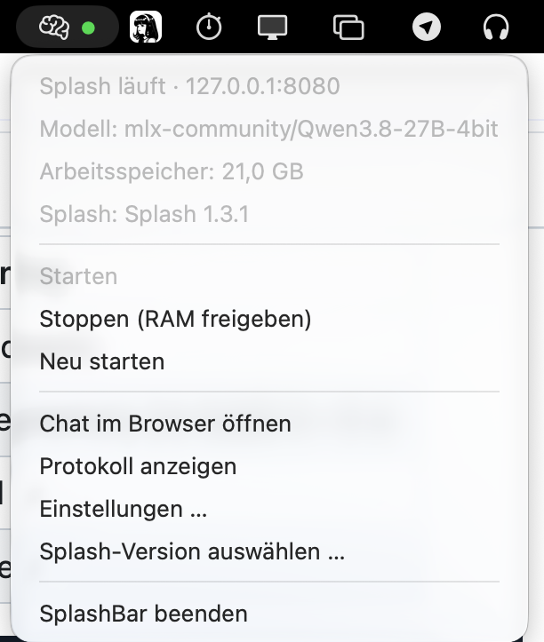

# SplashBar

**Language: English | [Deutsch](README.de.md)**

A tiny macOS menu bar app to control a local [Splash](https://github.com/incoai/splash)
inference server: start/stop/restart the `launchctl` service, watch the model's
GPU memory footprint, see the model that is actually loaded, switch between
published Splash releases, and jump straight to the built-in chat page.

The status dot in the menu bar does the talking:

| Dot | State | Meaning |
|-----|-------|---------|
| 🟢 green | serving | model loaded, answering requests |
| 🔵 blue | idle | loaded but unloaded to save memory (re-loads in ~5 s) |
| 🟠 orange | loading | server up, pulling the model in |
| ⚪ gray | stopped | agent stopped, memory freed |

The menu below is shown in German because that is SplashBar's development
language; all menus follow the macOS system language and are localized in
seven languages (de, en, fr, es, ja, zh, ru).



## What it does

- Shows the Splash server state in the menu bar (● green = serving, blue = idle,
  orange = loading model, gray = stopped)
- Reads the real memory footprint via `footprint(1)` — the model lives in
  GPU/phys_footprint, not in RSS
- Start / Stop (frees RAM + VRAM) / Restart without opening Terminal
- Opens the chat UI at `http://127.0.0.1:8080` and the server log
- Selects the model ID passed to `splash serve --model`
- Chooses the context size passed to `splash serve --max-context` (auto = the model's native window)
- Optionally passes an API key and an allowed host to the server
- Shows the Splash version in use and can switch between the globally installed
  Splash and published stable GitHub releases; release versions are downloaded
  to `~/.splashbar/splash-versions` and used by SplashBar only, without touching
  your PATH
- Shows the model that is currently loaded (live, from the server's `/v1/models`)
- Shows the SplashBar version at the top of the menu
- Backs the model cache up to `~/SplashBar-Backups` and restores it from a
  backup — the current cache is set aside while the archive is unpacked and is
  put back if anything fails, so a restore can never destroy a working model
- Lets you move the model cache itself (the Hugging Face directory Splash
  reads, passed as `HF_HUB_CACHE`) in the settings

No dependencies, no installer, no daemon of its own — one Swift file, built
with the Swift toolchain that ships with macOS.

## Requirements

- macOS 26.4+ (matching the Splash engine)
- [Splash](https://github.com/incoai/splash) installed and running as the
  launchd agent `local.llm.splash` with the chat page on port 8080 — or pick
  one of the stable GitHub releases in the version menu; SplashBar then
  manages its own copy in `~/.splashbar/splash-versions`
- `footprint` tool from Apple's `dev-tools` package (for the memory readout;
  without it the app still works, just shows no number)

## Build & run

```sh
bash build.sh            # builds /Applications/SplashBar.app + launch agent, starts it
```

The build script also (re)registers the `local.splashbar` LaunchAgent so
SplashBar auto-starts at login, and keeps the splash agent's `RunAtLoad`
in sync with the app's **Launch at login** setting — with it off, the splash
executable no longer starts at login on its own; the menubar app remains the
only controller of the splash executable.

### Configuration

Open **Settings …** from the SplashBar menu to configure your Splash
installation. Settings are saved for the current macOS user and take effect
without rebuilding the app. [The full reference for every setting](docs/SETTINGS.md)
([German](docs/SETTINGS.de.md))
covers where each one applies and how "Save" propagates to the LaunchAgent.

| Setting | Default |
|---------|---------|
| Launch at login | Matches what is on disk — also gates the splash executable's auto-start at login |
| Server URL (chat and API health check) | `http://127.0.0.1:8080` |
| Splash LaunchAgent label | `local.llm.splash` |
| Splash LaunchAgent plist | `~/Library/LaunchAgents/local.llm.splash.plist` |
| Splash log | `~/Library/Logs/Splash/splash.log` |
| Status refresh interval | 5 seconds |
| API request timeout | 2 seconds |
| Idle memory threshold | 3 GB |
| Splash model ID | Read from the LaunchAgent; empty until configured |
| Context size (--max-context) | Auto — the argument is left out |
| API key (--api-key) | None — the argument is left out |
| Allowed host (--allowed-host) | None — the argument is left out |
| Additional model search folder | None |
| Model cache directory | `~/.cache/huggingface/hub` (the Hugging Face default) |

The server URL is shared by the chat shortcut and the `/v1/models` health
check. Paths may start with `~` to refer to your home directory. Choose a
suggested model or enter a custom repository ID such as
`mlx-community/Qwen3.8-27B-4bit` in the editable model field.
Saving a new model or a different context size updates the configured Splash
LaunchAgent. If the server is already loaded, SplashBar asks: restart it to
apply the changes immediately, or save the changes and apply them the next
time the server starts, without interrupting the running instance. If the
server is stopped, the LaunchAgent is prepared and the next **Start**
action starts it.

The context size caps the window available per conversation; `Auto` lets
Splash keep the model's native window when memory allows and is not written
to the LaunchAgent at all.

The API key and the allowed host are optional. When set, they are written to
the Splash LaunchAgent as `--api-key` and `--allowed-host`; when empty, the
argument is left out entirely.

The model list scans the Hugging Face cache used by Splash (`HF_HUB_CACHE`,
`HF_HOME/hub`, or `~/.cache/huggingface/hub`) and LM Studio's
`~/.lmstudio/models` folder. An optional additional folder can be entered in
settings or selected with **Browse …** in the folder picker; the model
lists are rescanned immediately after choosing it. It is scanned alongside
those standard locations. Models found in these folders are listed by
repository ID. The selector has separate lists
headed with the installed Splash version: compatible models are above, while
incompatible and unverified models are below. Legacy `*-Splash` packages are
marked compatible through Splash 1.3.0 and incompatible with Splash 1.3.1 or
newer. Other discovered repositories are marked unverified unless they are
one of the built-in model suggestions. A local folder being found does not by
itself guarantee that its model format is supported by the installed Splash
version. A separate editable field accepts a custom repository ID.

The **Model cache directory** setting controls where the model files actually
live: it is written to the Splash LaunchAgent as `HF_HUB_CACHE`, so Splash
downloads and reads its models there instead of in the Hugging Face default.
An empty field uses the default. Moving the directory is a one-time step —
existing model files must be copied or moved there (or restored from a
backup) before the next model load.

**Choose Splash version …** loads the stable releases from the official
GitHub Releases API. The first entry is the Splash installed on your system
(for example via Homebrew), checked against the `splash` executable on your
PATH; the remaining entries are stable releases that include the macOS ARM64
runtime archive and its SHA-256 checksum. If the release list cannot be
loaded (no network, or GitHub is down), SplashBar lists the versions already
installed in `~/.splashbar/splash-versions` instead; versions that are
installed locally are marked `(installed)`. Selecting a release version
downloads the archive (with a progress bar) and extracts it to
`~/.splashbar/splash-versions/<version>` — nvm-style, with every version
kept side by side for later switching. SplashBar uses these local copies
internally only; nothing else on your system, including your PATH, is
modified. SplashBar asks before the switch and restarts a loaded server
afterward; a stopped server remains stopped. Check model compatibility before
switching; Splash 1.3.1, for example, no longer loads the older `*-Splash`
packages. After confirming a version change, SplashBar shows a progress window. While
the archive is being downloaded the window offers a **Cancel** button;
confirming the cancellation aborts the download, deletes the partially
created `~/.splashbar/splash-versions/<version>` directory, and keeps the
previously active Splash version selected. If the operation fails, the window
points to a detailed log with command output and the application stack trace
in `~/Library/Logs/SplashBar/`.

### Backing up the model

The menu offers **Back up model …** and **Restore model …**. A backup
archives the model cache (by default `~/.cache/huggingface/hub`) to
`~/SplashBar-Backups/models-<timestamp>.tar` in a progress window — the
running server and the cache itself are untouched, and the backup can be
cancelled (the partial archive is deleted). A restore works transactionally:
the current cache is moved aside, the archive is unpacked in its place, and
if anything fails the old cache is put back, so a failed restore cannot
destroy a working model. Choose one of the existing archives in a file
picker; the most recent ones are listed first. Use a backup before deleting
the cache to reclaim disk space — restore it later with **Restore model …**.

## Uninstall

```sh
launchctl bootout gui/$(id -u)/local.splashbar
rm ~/Library/LaunchAgents/local.splashbar.plist /Applications/SplashBar.app
```

## Contributing

See [CONTRIBUTING.md](CONTRIBUTING.md). Bug reports and feature requests are
welcome — open an issue, especially if your Splash install lives at a
different port or label.

## License

MIT — see [LICENSE](LICENSE).
